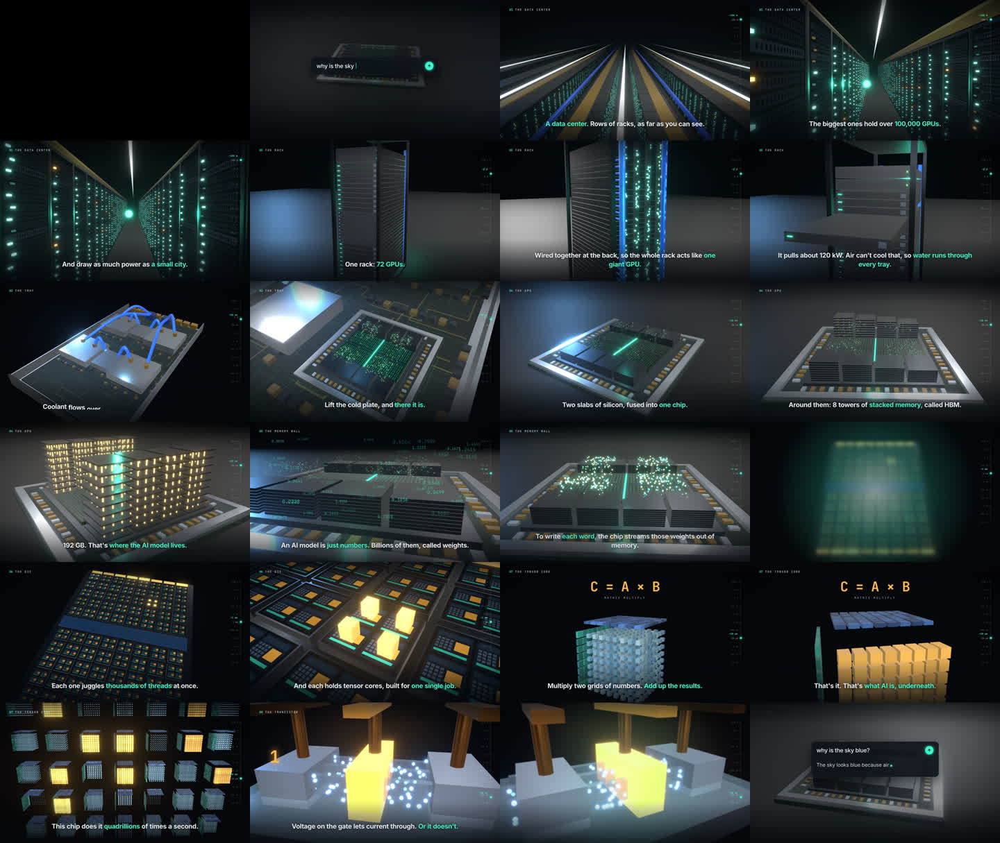

# explainer-video-3d

An Agent Skill for Claude Code / Codex: 2-3 minute narrated 3D explainers made entirely in code. Remotion + three.js for the picture, a numpy synth for the score, a TTS voice (via OpenRouter) for the narration, one `timeline.json` driving all three, rendered to mp4 on a laptop.

`reference/` is a finished 2:40 video, "How an AI chip works": a question flies into a data center and the camera follows it down to a single transistor.



Install:

```bash
git clone https://github.com/arthurkatcher/explainer-video-3d ~/.claude/skills/explainer-video-3d
```

Then ask your agent for "a 3D explainer on how X works". For narration, put `OPENROUTER_API_KEY=...` in the project's `.env` (about $0.03 per video with Grok Voice).

For short 2D motion-graphics explainers, see [explainer-video](https://github.com/arthurkatcher/explainer-video).
